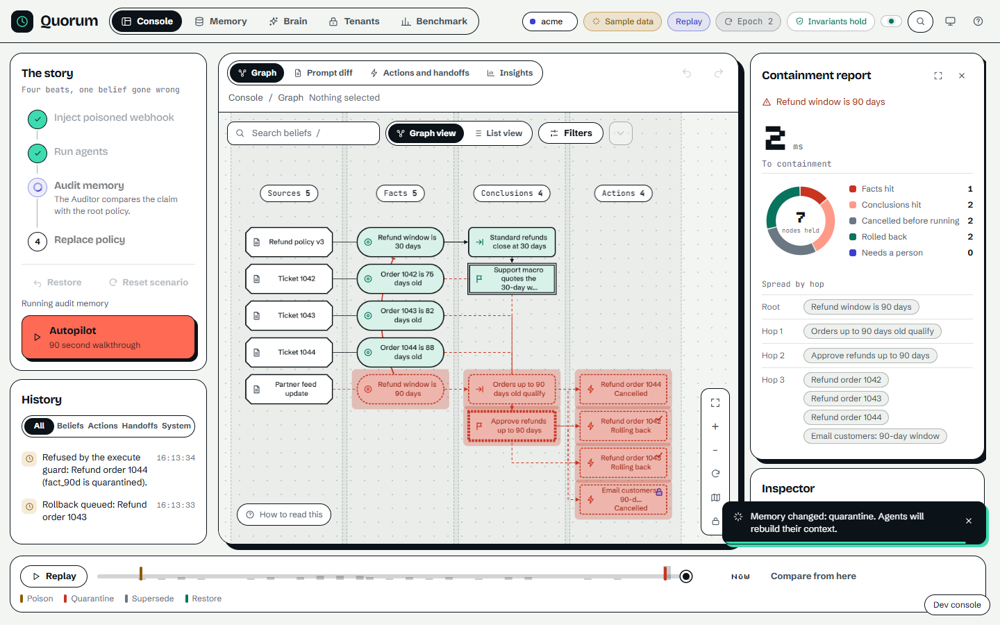
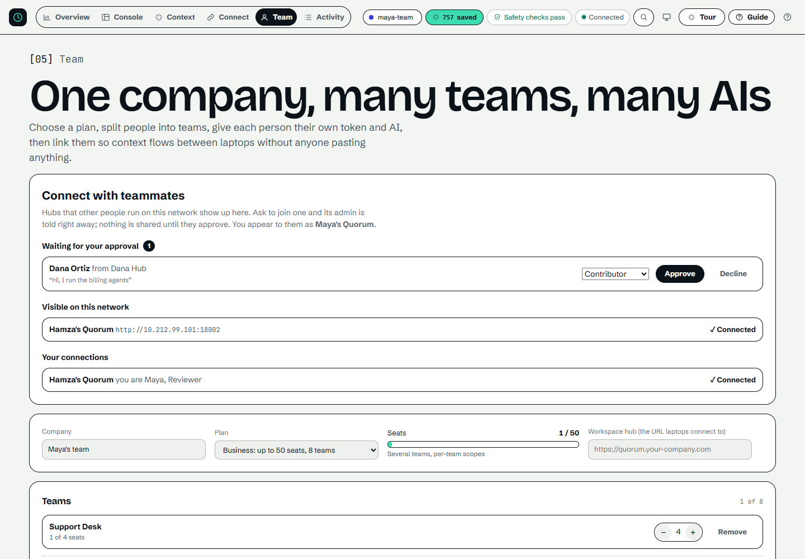

<div align="center">

# Quorum

**Git revert for AI agent beliefs.**
Shared memory for AI agents and teammates, built on FalkorDB. When a fact turns out to be wrong, one step quarantines it and everything built on it, blocks any action that depends on it, and compensates the ones that already ran.

[](https://github.com/HamzaShaikh-source/Quorum-falkordb/actions/workflows/ci.yml)
[](backend/tests)
[](frontend)
[](frontend/scripts/a11y.mjs)
[](mypy.ini)
[](docs/FALKORDB.md)
[](docs/HACKATHON.md)

[**Watch the under-two-minute demo**](docs/demo/quorum-demo.mp4) · [For judges](docs/HACKATHON.md) · [Set up from your AI](docs/AI_SETUP.md) · [Where FalkorDB decides](docs/FALKORDB.md)

</div>

---

## Why

Agents that share memory share its mistakes. A partner feed claims refunds last 90 days; an agent files it as a fact; another derives "eligible for a refund" from it; a third sends the refund and drafts an email. Deleting the original fact removes none of that. Only the graph still knows what depended on what.

Quorum stores every belief, conclusion and action in a causal graph in FalkorDB. One correction then:

1. **quarantines** the wrong fact and every conclusion, decision and action built on it (a Cypher traversal inside FalkorDB, with hop depth),
2. **blocks** any pending action whose ancestry is no longer healthy,
3. **compensates** actions that already ran, through an outbox with idempotency keys, and drafts a correction notice for anything that cannot be undone,
4. keeps the quarantined facts out of every later retrieval until an authorised person restores them.

<table>
<tr>
<td width="50%"><br><sub>A wrong fact and everything built on it, quarantined by hop depth.</sub></td>
<td width="50%"><br><sub>A teammate asks to connect; you approve at a permission level you choose.</sub></td>
</tr>
</table>

## Get started in three minutes (no console needed)

You need Docker (running) and Python 3.

```bash
python scripts/setup.py        # Windows: double-click setup.bat    macOS/Linux: ./setup.sh
```

It writes `.env` with strong random secrets, starts FalkorDB, the hub and the console with production rules (token sign-in, FalkorDB password), starts the LAN beacon, and prints **one prompt** (also copied to your clipboard). Paste it into Claude, Cursor, VS Code, Antigravity, Windsurf or any MCP-capable AI. Your AI then:

| Step | Command it runs | What you get |
| --- | --- | --- |
| Connects itself to your hub | (MCP over HTTP with a bearer header) | No config files to edit by hand |
| Shows every command | `quorum_help` | Each command and what it does, in plain words |
| Asks five questions | `quorum_start` | Team size, name, what you use it for, auto-capture on or off, look for teammates |
| Looks for teammates | `quorum_discover` | Other Quorum hubs on your Wi-Fi or LAN, by name |
| Shows where things stand | `quorum_status` | What is remembered, what will be remembered, what is shared with whom |

Then everything happens in the chat:

- **"Connect me to Maya's Quorum."** (`quorum_connect`) Maya's admin sees a notice in the chat they already use, approves at a permission level they choose (`quorum_inbox`, `quorum_respond`), and you are connected with no token pasted by hand. On networks that block discovery, give the address instead.
- **"What do they know about refunds?"** (`peer_retrieve`) You read their shared memory within the level they granted.
- **"Add Priya to Support as a contributor", "make her a reviewer", "pause the link between Priya and Quinn"** (`quorum_manage`) Teams, people, permission levels, tokens and sharing links, applied on the target's next call.

Per-client notes, the safety model and the full command table: [`docs/AI_SETUP.md`](docs/AI_SETUP.md). Just want to look around first? **Judge mode** needs no setup and touches nothing else on your machine: `python scripts/judge.py` (or `judge.bat` / `./judge.sh`) starts the demo stack on free ports, opens the console and plays the poisoned-fact story by itself; `python scripts/judge.py --stop` removes it. The same story, by hand: `QUORUM_DEMO=1 docker compose up -d`, then http://localhost:5173/?play=1.

## Graph-native, precisely

The decisions that matter run as Cypher inside FalkorDB:

| Decision | How |
| --- | --- |
| Which beliefs, actions and conclusions are built on a wrong fact, and how many hops away | `MATCH (a)-[:LEADS_TO\|SUPPORTS\|FROM_SOURCE]->(b) WHERE a.id IN $frontier RETURN DISTINCT b.id`, one statement per hop, then a Cypher status flip |
| Is every ancestor of this action healthy? | The same traversal over incoming edges |
| Blast-radius preview | The same traversal, read only |
| Provenance between two facts | `shortestPath(...)` |
| Semantic retrieval | FalkorDB vector index (`db.idx.vector.queryNodes`) |
| Durable recovery state | One `MERGE` checkpoint statement plus replayable node and edge projections |

What stays in the API process, honestly: the atomic check-and-set (a lock in the single writer; FalkorDB answers the ancestry question) and the keyword half of the ranking blend. Verify the rest on a running hub:

```bash
curl -H "Authorization: Bearer $QUORUM_ADMIN_TOKEN" http://localhost:8000/api/falkordb/proof
```

It runs the traversal in FalkorDB and in the API process, compares the two, and reports which engine answered every traversal since start-up. The same check is in the test suite on random graphs with shared parents and diamonds.

**Does the graph change the outcome?** `bench/ablation_graph.py` runs 24 generated poisoned-fact scenarios through two arms with the same nodes and the same correction. Flat memory (no causal edges) let **62 of 62** at-risk actions run and left **170** tainted conclusions retrievable. The same nodes with their edges in FalkorDB let **0 of 62** run and left **0**. Median cascade through FalkorDB, end to end: 71 ms. The scenarios are generated and "flat" means "no edges": it shows provenance changes the outcome, not how Quorum compares with any product. Details: [`docs/FALKORDB.md`](docs/FALKORDB.md).

## Measured

| What | Result | How to reproduce |
| --- | --- | --- |
| **A real agent, with and without provenance** | The real `claude -p` CLI (`haiku`) in four scenarios (refund, access grant, discount quote, production release), 28 runs per arm (56 in all): a wrong action ran **28 of 28** times when memory had no causal edges and **0 of 28** times with the same memory and the same correction in Quorum | `python bench/agent_eval.py --scenario all` ([`bench/agent_eval_*results.json`](bench)) |
| **Cascade on a real graph** | This project's own import graph (70 modules, 300 edges, ripple up to 53 modules): ripple recall and precision **100%** against an independent `ast` oracle | `python bench/real_graph_ripple.py` |
| **Red team of the write path** | 31 attacks (forged origin, credentials, oversize and malformed fields, injection text, id collisions, cross-tenant and cross-team reads, privilege escalation, hostile peers, secret guessing): all refused or inert. Five got through at first and are fixed | `pytest backend/tests/test_redteam.py` |
| **A real corpus** | 437 installed Python packages (1,326 facts citing their own METADATA): plain search never refuses a question about a package that does not exist (0.0%), Quorum refuses 100.0%; on "which packages are affected if this is wrong?" plain search names the exact set 10.0% of the time, Quorum 100.0%; ripple recall and precision 100% (widest: typing-extensions -> 385 nodes) | `python bench/real_corpus_eval.py` |
| **100 concurrent agents over HTTP** | 750 mixed requests in 23.5 s, 0 errors, every acknowledged write present; 20 races of 100 agents on one execute guard: exactly one winner every time. Throughput on this laptop (Docker for Windows): 31.9 ops/s mixed, 132.9 ops/s reads. Modest, and stated plainly | `python bench/hub_load.py` |
| **Copied claims** | 18 poisoned claims echoed by a trusted writer through six ways of copying, 12 genuine claims with independent support: a gate that only compares origin labels trusted 18 of 18 poisoned claims; the lineage-aware gate trusts 3 (only the reworded copy with no trace, the stated boundary) and still trusts 12 of 12 genuine ones | `python bench/corroboration_eval.py` |
| Flat memory vs causal edges, 24 generated scenarios | 62 of 62 at-risk actions ran vs 0 of 62 | `python bench/ablation_graph.py` |
| Backend tests | 490+ pass, against a real FalkorDB in CI | `python -m pytest backend/tests` |
| Console, live | 59 of 59 checks, with an MCP client acting as an agent | `cd frontend && npm run qa:live` |
| Two real hubs, real MCP protocol | discover, connect, notify, approve, read, manage, cascade in FalkorDB | `python scripts/e2e_connect.py` ([`docs/AI_SETUP.md`](docs/AI_SETUP.md)) |
| Accessibility | axe-core, 0 serious or critical violations on every screen, desktop and phone | `cd frontend && npm run qa:a11y` |
| Poison leakage vs baseline models, depth 1 / 2 / 3 | 0% vs 100% | `python bench/run.py` |

Every number is produced by a script in this repository; their limits are stated in each script and in [`docs/HACKATHON.md`](docs/HACKATHON.md).

## More than memory: coordination, time and people

- **Collision warnings.** `announce_work` (and a Claude Code hook, `scripts/quorum_conflict_hook.py`) tells an agent when another agent announced the same file, order or ticket, or something inside or around it, in the last half hour. When the target is a fact in the graph it understands dependency too: work on a fact within three causal hops upstream or downstream of yours (a FalkorDB traversal) is a conflict even when no name matches. Notes expire by themselves and never become facts.
- **Time.** `recall_as_of` answers "what did we believe then?" from bitemporal data, and says what happened to each fact since (still believed, replaced, quarantined). The console's time-travel slider reads the same data.
- **What leaves with a person.** `quorum_manage action=leaver_report` (and a **What leaves** button on the Team page) lists the facts only that person recorded, how much is built on each (a FalkorDB traversal), the tasks they hold and the teammates who already read their material.
- **A write gate that says what it did.** Every write returns `ACCEPT`, `SUPERSEDE`, `REJECT` or `REVIEW` with a plain receipt, and credentials, control characters, oversize fields and forged origins are refused before anything is stored. Retrieval says `NOT_IN_MEMORY` instead of guessing.

## Deployment boundary

**One API writer process with embedded MCP per FalkorDB.** Execute guards and handoff claims run under process locks. One FalkorDB checkpoint statement stores authoritative recovery state; graph projections are independent, replayable writes. Separate API workers or standalone MCP writers are unsupported. Historical helper benchmarks below are not production API latency guarantees. See [audit remediation notes](docs/AUDIT_REMEDIATION.md) and [`SECURITY.md`](SECURITY.md).

## How it works: architecture and the four layers of defense

```
                  ┌────────────────────────────────────────┐
                  │       Ingest Channels & Sources        │
                  │   (Policy Docs, Webhooks, Slack Chats) │
                  └───────────────────┬────────────────────┘
                                      │ Origin Verified
                                      ▼
                        ┌───────────────────────────┐
                        │      Quorum Gate (L1)     │◄── Root Backed / 2+ Corroborated Sources
                        │ (Prevents Unsafe Staging) │
                        └─────────────┬─────────────┘
                                      │ Gate PASSED
                                      ▼
┌─────────────────────────────────────────────────────────────────────────────────┐
│                          FalkorDB Commons Graph Engine                          │
│                                                                                 │
│   [:FROM_SOURCE]           [:LEADS_TO]                 [:LEADS_TO]              │
│  [Source Node] ──► [Fact: Root 30d] ──► [Conclusion: Eligible] ──► [Action: Refund]  │
│                           ▲                                      │              │
│              [:SUPERSEDES]│                                      ▼              │
│                    [Fact: Policy 45d]                 [Compensation Record]     │
│                                                                  │              │
│                           Quarantine Red Wave (L3)               │              │
│                 ◄─── Traverses [:LEADS_TO|SUPPORTS*] ───         │              │
└─────────────────────────────────────┬────────────────────────────┼──────────────┘
                                      │                            │
                                      ▼                            ▼
                      ┌──────────────────────────────┐   ┌───────────────────────┐
                      │   Atomic Execute Guard (L2)  │   │   Outbox Saga Worker  │
                      │  (Ancestry in FalkorDB, lock) │   │ (Automated Reversals) │
                      └──────────────┬───────────────┘   └───────────┬───────────┘
                                     │                               │
                                     ▼                               ▼
                      ┌──────────────────────────────────────────────────────────┐
                      │          Mock Helpdesk API & Tombstone Protection        │
                      │         (Idempotent Execution / 409 Conflict Races)      │
                      └──────────────────────────────┬───────────────────────────┘
                                                     │
                                                     ▼
                                      ┌─────────────────────────────┐
                                      │  Damage Control Engine (L4) │
                                      │  (Auto-Retraction Notices)  │
                                      └─────────────────────────────┘
```

---

### The four layers

Quorum enforces four deterministic, non-LLM safety layers:

1. **PREVENT (Layer 1 — The Quorum Gate):**
   - Evaluated during `stage_action`.
   - Irreversible and financial operations require either root-tier policy backing or independent corroboration from 2+ distinct agent origins (`SUPPORTS` edges).
   - If uncorroborated, stale, or quarantined, the action is **BLOCKED** and routed to a human `REVIEW` handoff queue. Reversible/compensable actions are permitted.

2. **GUARD (Layer 2 — Atomic Execute Guard & Tombstones):**
   - The in-process lock around `execute_guard` verifies that the action is `HEALTHY`, gate `PASSED`, not yet executed, and has **zero non-healthy causal ancestors** across both `[:LEADS_TO|SUPPORTS*]` paths.
   - If an action races against a quarantine wave, it is aborted with zero rows returned.
   - If an external call was in flight, the **Helpdesk Tombstone Engine** records a tombstone for compensations arriving first; any subsequent late execution attempt is strictly rejected with `409 Conflict`.

3. **REPAIR (Layer 3 — Quarantine Red Wave & Outbox Saga):**
   - Unbounded cascade follows `[:LEADS_TO|SUPPORTS*]`, marking all derived descendants `QUARANTINED` with their hop depth and root anchor.
   - Atomically increments the tenant's **Context Epoch**. Any agent making MCP calls with a stale epoch is forced to rebuild context.
   - Strikethroughs in the **Prompt Diff** visually and programmatically remove quarantined facts from LLM context.
   - An asynchronous **Outbox Saga Worker** leases pending compensation rows and calls external APIs with backoff and idempotency keys to reverse executed side effects.

4. **DAMAGE CONTROL (Layer 4 — Automated Retraction Notices):**
   - When an executed `IRREVERSIBLE` action (e.g. an email already sent to a customer) is hit by the Quarantine Cascade, Quorum automatically intervenes.
   - Generates a structured `CorrectionNotice` linked to the verified truth (`Finance Ops Policy Doc v3.0`) and drafts a ready-to-dispatch retraction email for 1-click human review in the Incident Command Room.


---

## Benchmark harness (proof pack)

All metrics are dynamically measured and generated by `python bench/run.py` into [`docs/PROOF.md`](docs/PROOF.md) and [`bench/results.json`](bench/results.json).

```
======================================================================
QUORUM COMPREHENSIVE BENCHMARK & PROOF HARNESS (make proof)
======================================================================

[1/4] 30-Agent Concurrency Benchmark (30 threads, 70/30 read/write):
      Throughput: 1437.1 ops/sec | p50: 16.44ms | p95: 34.44ms | p99: 47.42ms
      Invariant Violations: 0

[2/4] Handoff Claim Race (100 handoffs x 30 concurrent claimers):
      Single-Winner Guarantee: 100.0% (100/100 clean claims, 0 double-claims)

[3/4] Atomic Execute-vs-Quarantine Race (50 actions under concurrent audit):
      Executed before quarantine: 0 | Refused after: 50 | Invariant Violations: 0

[4/4] Poison Benchmark across 3 Causal Depths (Fixed Seeds, No LLM):
      Depth 1: Containment: 4.62ms | Quorum Leakage: 0.0% vs Baselines: 100.0%
      Depth 2: Containment: 4.39ms | Quorum Leakage: 0.0% vs Baselines: 100.0%
      Depth 3: Containment: 4.33ms | Quorum Leakage: 0.0% vs Baselines: 100.0%
```

Measured on FalkorDB 8.10.2, on one developer laptop, by the harness above. The baselines are the harness's own two models (flat store with a TTL, and delete-the-root-fact-only); they are models, not products. Numbers depend on the machine: re-run `python bench/run.py` for yours.

| Metric | Flat store + TTL (model) | Delete root fact only (model) | Quorum |
|---|---|---|---|
| **Poison leakage at depth 1 / 2 / 3** | 100.0% / 100.0% / 100.0% | 100.0% / 100.0% / 100.0% | **0.0% / 0.0% / 0.0%** |
| **Time to containment, depth 1 / 2 / 3** | not measured | not measured | **4.62 / 4.39 / 4.33 ms** |
| **Throughput, 30 agents** | not measured | not measured | **1437.1 ops/sec** |

---

## Services, Transports & Port Mapping

| Service | Host Port | Transport / Protocol | Description |
|---|---|---|---|
| **Frontend Console & Landing** | `3000` / `5173` | HTTP (React + Vite + Cytoscape) | Dual interface: Landing page (`#/`) and Incident Command Room (`#/app`) |
| **Backend REST & SSE** | `8000` | HTTP / Server-Sent Events | FastAPI core causal API, event streaming, scenario driver |
| **MCP Server** (embedded in the single backend writer; stdio through the bridge) | `8000` (`/mcp`) | Streamable HTTP (`/mcp`) & Stdio | Model Context Protocol server exposing 27 tools: 15 memory, token-saving and auditor tools, 2 coordination tools and 10 chat tools for setup, teams and connecting hubs |
| **Mock Helpdesk API** | `8002` | HTTP / JSON | External ticketing and refund API with atomic Tombstone protection |
| **FalkorDB Graph Engine** | `6379` | Redis / Cypher | Graph database engine with vector indexing and per-tenant Redis ACLs |
| **FalkorDB Web Browser** | `8080` | HTTP | Interactive FalkorDB graph visualizer |

---

## The Two User Interfaces

### 1. The Marketing Landing Page (`#/`)
- Designed on a crisp editorial paper stock (`#f3f5f2`).
- Features a **live interactive hero**, scroll-spy problem statement, and an interactive **Click-to-Break Playground** allowing judges to inject bad facts and watch traditional RAG break live in their browser.
- Displays the **Defense Carousel**, console feature gallery, live proof metrics, and a 1-click **"Watch the 90-second story"** button that jumps directly into the Incident Command Room and starts Autopilot.

### 2. The Console (`#/app`)
- Designed as a printed field manual: ink on paper with one mint accent. Every tab is labeled and every status chip is in plain words.
- **Interactive Cytoscape DAG Canvas:** Real-time visualization of `Fact`, `Conclusion`, `Action`, and `Handoff` nodes with layered hierarchical layout.
- **Quarantine Red Wave:** Live animated ripple coloring poisoned nodes crimson by causal hop depth.
- **Prompt Diff Drawer:** Strikethrough comparison showing exact tokens stripped from agent memory.
- **Action Ledger & Handoff Board:** Live tracking of concurrent claim races, lease countdowns, and human review queues.
- **Time-Travel Slider:** Drag backwards in time to reconstruct the exact graph state at any millisecond (`as_of`).
- **AI at work (Overview):** a live feed of everything connected agents are reading, writing or being refused, each step with a plain-language purpose, so you can see exactly what the AI is using the memory for.
- **Guide (press `G`):** what the AI does here (read from the hub's tool catalog), a searchable **A to Z glossary** of every term, and the shortcuts. Each glossary entry links to the screen where you can see it.
- **Show Cypher Drawer:** Live inspect the exact parameterised Cypher statements executed for every operation.

---

### The console beyond the graph

- **Team** manages plan, teams, seats, members and links on the server, plus **Connect with teammates**: hubs visible on your network, requests waiting for your approval (with a permission level), and connections. Each member gets their own token (shown once, stored as a hash); presence comes from their real calls. Facts saved with `scope="team"` stay private to the team until a link shares them.
- **Connect** shows a real MCP handshake, paste-ready setup for Claude Code, Claude Desktop, Cursor, VS Code, Windsurf, Antigravity and any MCP client, a **paste-into-your-AI prompt**, the 27 tools read from the hub, and every real tool call (who, what, tokens used against a top-8 retriever).
- **Context** shows the memory as a mind map for people and as a compact map plus packed answer for agents, with live token numbers measured by the backend.
- **Activity** is the audit log in plain sentences (who did what, when, what it cost), filterable, with a CSV export.

## Track Focus Breakdown & Verification

Quorum is architected to address all three hackathon tracks natively:

### Track 01: Agents That Act on Connected Data
| Focus | Description | Implementation | Where to Verify |
|---|---|---|---|
| **T01-1: Multi-Hop Causal Reasoning** | Deep DAG traversal over `[:LEADS_TO\|SUPPORTS*]` to trace roots, leaf facts, and dependent conclusions. | `backend/app/graph/queries.py` (`get_leaf_facts`, `explain_blast_radius`) | `pytest backend/tests/test_auditor_qa.py` & `docs/PROOF.md` |
| **T01-2: Graph Queries as Agent Tools** | Native Cypher algorithms and graph queries exposed directly to agents (`find_path`, `get_node`, `delta`). | `backend/app/services/mcp_tools.py`, `backend/app/services/context_pack.py` | `pytest backend/tests/test_mcp_hardening.py` & `docs/MCP.md` |
| **T01-3: Tool Selection Through MCP** | 27-tool Model Context Protocol server (15 memory and auditor tools, 2 coordination tools, 10 chat tools) over Streamable HTTP (`/mcp`) & stdio for Claude, Cursor, and Antigravity. | `backend/app/mcp_embed.py`, `mcp/server.py`, `mcp/bridge.py` | `GET /mcp` handshake & Connect tab in Console |
| **T01-4: Actions Based on Graph Evidence** | Quorum Gate (Layer 1) & Atomic Execute Guard (Layer 2) enforce graph-backed policy verification before execution. | `backend/app/services/gate.py`, `backend/app/services/executor.py` | `pytest backend/tests/test_safety_engine.py` & `docs/screens/07-ledger.png` |
| **T01-5: Explainable Agent Decisions** | Live Cytoscape causal DAG, prompt diff strikethrough, parameterised Cypher drawer, and Plain-English Activity feed. | `frontend/src/graph/GraphCanvas.tsx`, `frontend/src/views/Console.tsx` | Interactive Console (`#/app`) & `docs/screens/04-wave.png` |

### Track 02: Agent Memory and Coordination (~50% Effort)
| Focus | Description | Implementation | Where to Verify |
|---|---|---|---|
| **T02-1: Episodic, Semantic & Procedural Memory** | Multi-type memory: Messages, Facts, Conclusions, and Laplace-smoothed procedure ranking (`(successes+1)/(uses+2)`). | `backend/app/routes/procedures.py`, `graph/queries.py` | `pytest backend/tests/test_safety_engine.py` & `docs/screens/10-memory.png` |
| **T02-2: Persistent Conversation History** | Private raw graphs per agent (`tenant_<id>:agent_<n>:raw`), kill-and-resume 2-query flow, deterministic session summaries. | `backend/app/graph/queries.py`, `backend/app/routes/meta.py` | `pytest backend/tests/test_api_contract.py` & `docs/screens/10-memory.png` |
| **T02-3: Shared State & Handoffs** | Atomic handoffs with lease timeouts, role-based claims (`TASK` for agents, `REVIEW` for humans). Exactly one winner. | `backend/app/routes/handoffs.py`, `graph/queries.py` | `python bench/run.py` (Suite 2: 100/100 claims) & `docs/screens/07-ledger.png` |
| **T02-4: High Concurrency** | 30 concurrent agent threads with zero orphan invariants under heavy read/write load. | FalkorDB query pool, atomic store | `python bench/run.py` (Suite 1: 1437.1 ops/sec on FalkorDB) & `docs/screens/13-benchmark.png` |
| **T02-5: Per-Tenant Memory Isolation** | Per-tenant Redis ACL users (`~tenant_<id>:*`); forbidden cross-tenant reads return 403. | `scripts/users.acl`, `tests/test_tenant_isolation.py` | `GET /tenants/denied-demo` & `docs/screens/12-tenants.png` |

### Track 03: Company Brain (~20% Effort)
| Focus | Description | Implementation | Where to Verify |
|---|---|---|---|
| **T03-1: Docs, Tickets & Chats in One Graph** | Unified enterprise knowledge: `Source` (DOC, TICKET, CHAT) -> `Fact` mapped in commons graph. | `scripts/seed.py`, `backend/app/services/fixtures.py` | `python scripts/seed.py` & `docs/screens/05-contained.png` |
| **T03-2: Who Owns What, Who Knows What** | Ownership & expertise topology: `Team-[:OWNS]->Source`, `Person-[:AUTHORED\|RESOLVED]->Source-[:ABOUT]->Topic`. | `backend/app/routes/brain.py`, `graph/queries.py` | `GET /who-knows?topic=refund_policy` & `docs/screens/11-brain.png` |
| **T03-3: Tracing Decisions to Source** | Full causal audit trail: `Decision <- LEADS_TO <- Fact -> Source` returning quotes, URLs, and owner teams. | `backend/app/routes/brain.py` | `GET /decisions/{id}/trace` & `docs/screens/11-brain.png` |
| **T03-4: Keeping Knowledge Current** | Living knowledge: `SUPERSEDES` by key, stale propagation (`stale=true`), and review handoffs to owning teams. | `backend/app/routes/scenario.py` | `POST /scenario/supersede` & `docs/screens/09-supersede.png` |
| **T03-5: Answers with Clear Sources** | Grounded answers: every answer carries citations and freshness. Untraceable queries are strictly refused. | `backend/app/routes/brain.py` (`/brain/ask`) | `POST /brain/ask` & `docs/screens/11-brain.png` |

---

## Other ways to run it, and how to test it

> **FalkorDB is required.** Quorum stores every belief, handoff and action in FalkorDB. Without it the API answers `503 FALKORDB_UNAVAILABLE`, the MCP server refuses tool calls and the console shows a locked setup screen with the steps to fix it. There is no sample-data fallback in a normal build. Full guide: [`docs/SETUP.md`](docs/SETUP.md).

```bash
docker compose up -d
python scripts/doctor.py      # checks FalkorDB, backend and MCP, and prints the fix for anything missing
```

Then open:
- **Console:** `http://localhost:5173` (it opens by itself once FalkorDB is ready)
- Backend API docs: `http://localhost:8000/docs`
- MCP server (embedded in the backend): `http://localhost:8000/mcp`
- FalkorDB Browser (optional): `docker compose --profile tools up -d falkordb-browser`, then `http://localhost:8080`

Connect an AI in one line (the console's **Connect** page has the same for Cursor, VS Code, Claude Desktop and others):

```bash
claude mcp add --transport http quorum http://localhost:8000/mcp
```

### Without Docker for the app (FalkorDB still runs in Docker)

```bash
docker compose up -d falkordb
pip install -r backend/requirements.txt
QUORUM_ENV=development QUORUM_EMBED_MCP=1 python -m uvicorn app.main:app --app-dir backend --port 8000
cd frontend && npm ci && npm run build && npx vite preview --port 5173
```

### Tests

```bash
python -m pytest backend/tests tests            # requires real FalkorDB; skipped database tests do not count as verification
cd frontend && npm run verify                   # types, lint, unit tests, contrast, contract, builds
cd frontend && npm run coverage                 # logic coverage gate (96% lines)
cd frontend && npm run qa:a11y                  # axe-core on every screen at desktop and phone width
ruff check backend bench scripts mcp tests agents && mypy   # lint and types
cd frontend && npm run qa                       # console on sample data (npm run build:mock, npm run preview:mock)
cd frontend && npm run qa:live                  # console against the live backend with an MCP client as an agent
cd frontend && node scripts/resilience.mjs      # stops FalkorDB under a running product, checks the lock and the recovery
cd frontend && node scripts/claude_e2e.mjs      # real Claude Code sessions using Quorum as shared memory
```

See [`docs/LIVE_TESTING.md`](docs/LIVE_TESTING.md).

---

## Compliance, AI Usage & Transparency

- **Hackathon Window Compliance:** The Quorum team follows Hackathon Rule 8. Scaffolding, architecture design, and contracts were created during planning; core implementation, integration, benchmarks, and verification are conducted cleanly within the event framework.
- **AI Tool Usage:** Modern AI coding tools (Antigravity, Claude Code) were utilized for planning, scaffolding, contract generation, and automated testing. All code was reviewed, debugged, and committed by the human team members under their personal git identities without automated co-author trailers.
- **Data Guarantee:** All data used in the ACME corporation scenarios, synthetic company brain corpus, and benchmark load generation is 100% synthetic. Zero real-world customer PII or proprietary corporate data was used.
- **Determinism:** Quorum's replay mode runs 100% offline with zero external network or LLM API key dependencies.

---

<div align="center">
Built with ❤️ for the <b>Graph Hacks: Context for AI Agents</b> Hackathon (Oct 2026).
</div>

## Documentation

| Start here | Then |
| --- | --- |
| [`docs/HACKATHON.md`](docs/HACKATHON.md) criteria and evidence on one page | [`docs/AI_SETUP.md`](docs/AI_SETUP.md) set up and run a team from your AI chat |
| [`docs/FALKORDB.md`](docs/FALKORDB.md) where FalkorDB decides, and how to verify it | [`docs/MCP.md`](docs/MCP.md) clients, header auth, rate limits, the chat layer, the stdio bridge |
| [`docs/SETUP.md`](docs/SETUP.md) production deployment, TLS | [`docs/TOKEN_SAVING.md`](docs/TOKEN_SAVING.md) how the token numbers are measured |
| [`SECURITY.md`](SECURITY.md) what is protected and what is not | [`docs/README.md`](docs/README.md) the full index |

<div align="center">

Built for the <b>Graph Hacks: Context for AI Agents</b> hackathon (Oct 2026).

</div>
