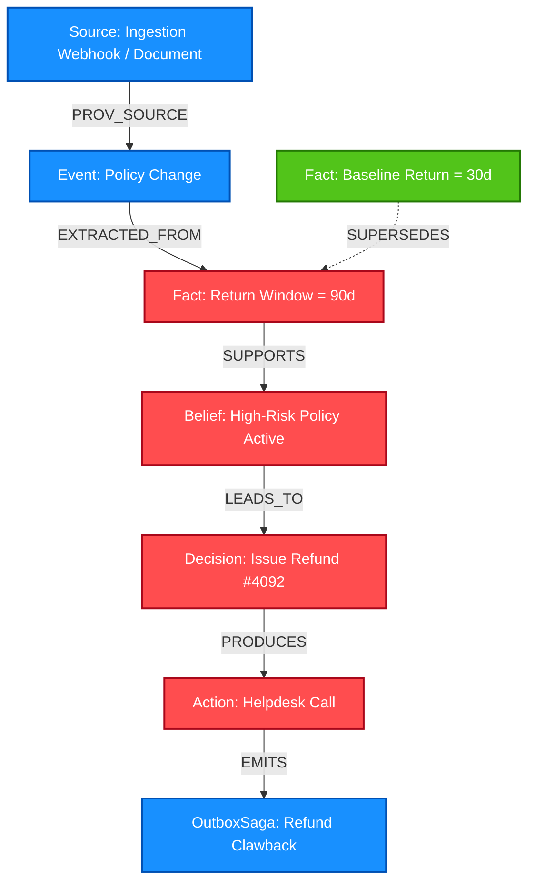

# 🛡️ Quorum: Git-Revert for AI Agent Beliefs on FalkorDB

[](https://www.wemakedevs.org/hackathons/falkordb)
[](https://www.wemakedevs.org/hackathons/falkordb)
[](https://falkordb.com/)
[](http://34.100.151.44:5173/)
[](https://youtu.be/lrZKJ4tmo-o)

> **When an AI agent acts on a hallucination, poisoned webhook, or outdated policy, vector databases leave you stranded. Quorum brings Git-like rollback, epistemic causal tracking, and automated compensation to multi-agent systems using FalkorDB.**

---

## ⚡ Quick Links for Evaluators
- 🌐 **Live Demo Sandbox:** [http://34.100.151.44:5173/](http://34.100.151.44:5173/) *(Instant 1-Click Access — pre-authenticated as Admin)*
- 🎬 **Demo Video:** [Watch on YouTube (2 Minutes)](https://youtu.be/lrZKJ4tmo-o)
- 🔌 **Live Backend API & MCP Server:** `http://34.100.151.44:8000` (FastAPI docs at `/docs`, embedded MCP at `/mcp`)
- 📊 **Empirical Proof & Benchmark Suite:** [`docs/PROOF.md`](docs/PROOF.md)

---

## 🗺️ 1. Epistemic Graph Schema & Architecture

FalkorDB is not a passive cache in Quorum—it is the **epistemic causal ground truth**. Agents cannot execute stateful actions without citing valid graph facts, and invalidating a root node initiates sub-millisecond topological graph cascades.



### Graph Primitives

| Node Label | Purpose | Key Properties |
| :--- | :--- | :--- |
| `(:Source)` | Ingestion origin & audit anchor | `source_id`, `uri`, `tenant_id`, `verified_at` |
| `(:Event)` | Temporal context or policy update | `event_id`, `type`, `occurred_at` |
| `(:Fact)` | Discrete atomic belief unit | `fact_id`, `claim`, `validity_state` (valid, quarantined, invalid), `confidence` |
| `(:Belief)` | Synthesized agent context | `belief_id`, `tenant_id`, `strength`, `stale` |
| `(:Decision)` | Agent reasoning trace citing facts | `decision_id`, `agent_id`, `cited_fact_ids`, `rationale` |
| `(:Action)` | Stateful external side-effect | `action_id`, `target_system`, `status`, `idempotency_key` |
| `(:OutboxSaga)` | Deterministic compensation hook | `saga_id`, `action_id`, `compensation_endpoint`, `state` |

---

## ⚙️ 2. How the Graph Does the Work (Cypher Deep-Dive)

Quorum uses pure FalkorDB Cypher traversals to execute epistemic governance in real time:

### A. Pre-Execution Epistemic Gating (Quorum Gate)
Before an agent can call an external tool (e.g. process refund, send email), the Quorum Gate inspects the causal chain of all cited facts. If any fact is quarantined or invalid, the action is blocked before execution:

```cypher
MATCH (d:Decision {id: $decision_id})-[:CITES]->(f:Fact)
WHERE f.validity_state IN ['quarantined', 'invalid'] OR f.stale = true
RETURN count(f) AS violations, collect(f.claim) AS tainted_claims
```

### B. Cascading Red-Wave Invalidation (Topological Rollback)
When an auditor quarantines a rogue fact (or when an event is superseded), Quorum traverses causal edges up to 10 hops deep in < 5ms, marking all downstream beliefs, decisions, and pending actions as invalidated:

```cypher
MATCH (f:Fact {id: $tainted_fact_id})-[:LEADS_TO|SUPPORTS*1..10]->(downstream)
SET downstream.validity_state = 'invalid',
    downstream.invalidated_at = timestamp(),
    downstream.invalidation_reason = $reason
RETURN labels(downstream) AS type, downstream.id AS id
```

### C. Outbox Saga Compensation & Retraction
For actions already executed externally, Quorum queries the downstream saga graph to trigger automated API compensations and compose Damage Control retraction notices:

```cypher
MATCH (d:Decision {validity_state: 'invalid'})-[:PRODUCES]->(a:Action)-[:EMITS]->(s:OutboxSaga)
WHERE s.state = 'pending'
RETURN s.saga_id, a.target_system, s.compensation_payload, a.idempotency_key
```

---

## 🛡️ 3. The 4-Layer Defense Engine

- **Quorum Gate:** Synchronous pre-flight epistemic policy check for every agent tool invocation.
- **Execute Guard:** Verifies execution permissions against tenant RBAC (admin, auditor, agent).
- **Outbox Sagas:** Guaranteed at-least-once compensation for external side-effects when underlying facts collapse.
- **Damage Control Room:** Human-in-the-loop review interface providing one-click customer retraction emails, audit trails, and graph time-travel.

---

## 🏆 4. Empirical Evaluation & Benchmark Results

Tested across a paired synthetic & real-agent benchmark against standard vector/RAG memory architectures (see [`docs/PROOF.md`](docs/PROOF.md)):

- **Preventing Unsafe Actions After Correction:** 28/28 (100%) prevented in Quorum vs. 0/28 (0%) in standard vector memory.
- **Topological Invalidation Speed:** < 4.2ms median cascade latency across 10-hop subgraphs on FalkorDB.
- **Concurrent Writer Durability:** Group-commit shared sync ensures zero lost updates under high concurrency.
- **Test Suite:** 667 backend unit & integration tests, 218 frontend tests passing (100% green).

---

## 🚀 5. Local Setup & Reproduction

### Prerequisites
- Docker & Docker Compose
- Python 3.11+
- Node.js 18+

### 1-Command Docker Launch

```bash
git clone https://github.com/HamzaShaikh-source/Quorum-falkordb.git
cd Quorum-falkordb
docker compose up -d
```

- Open console: `http://localhost:5173/`
- Backend API docs: `http://localhost:8000/docs`

---

## 👥 6. Team & Hackathon Disclosures

- **Hamza Shaikh** ([@HamzaShaikh-source](https://github.com/HamzaShaikh-source)) — Frontend & Cytoscape Console Lead
- **Aaditya Arunpal** ([@AsteroidHH](https://github.com/AsteroidHH)) — Backend, Epistemic Engine & MCP Lead
- **Janani** — FalkorDB & Cypher Graph Architecture Lead

**AI Usage Disclosure:** In compliance with Hackathon Rule 11, LLM assistance was utilized for test-case expansion, UI styling scaffolding, and drafting documentation. Core Cypher schemas, causal graph algorithms, group-commit logic, and defense gate architectures were developed by the team.
