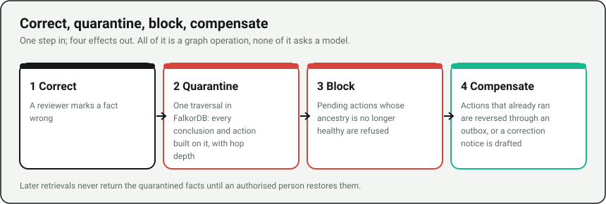
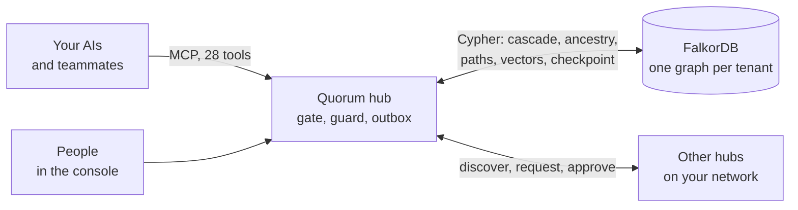
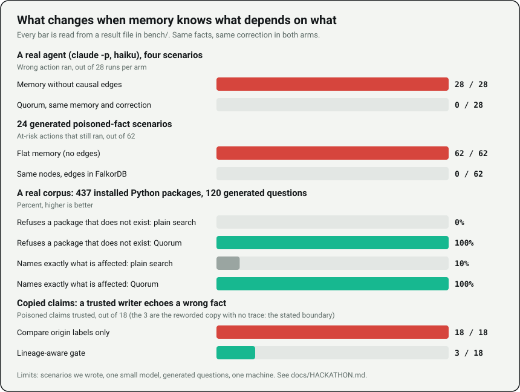

<div align="center">

# Quorum

### Git revert for AI agent beliefs.

Shared memory for AI agents and teammates, built on FalkorDB.<br/>
When a fact turns out to be wrong, one step quarantines it and everything built on it, blocks any action that depends on it, and compensates the ones that already ran.

[](https://github.com/HamzaShaikh-source/Quorum-falkordb/actions/workflows/ci.yml)
[](https://github.com/HamzaShaikh-source/Quorum-falkordb/releases)
[](docs/MCP.md)
[](backend/tests)
[](frontend)
[](frontend/scripts/a11y.mjs)
[](docs/FALKORDB.md)
[](LICENSE)

[**Try it in one command**](#try-it-in-one-command) · [**Set it up from your AI**](#set-it-up-from-your-ai-chat) · [**The evidence**](#the-evidence) · [**For judges**](docs/HACKATHON.md) · [**Use guide**](docs/USER_GUIDE.md) · [**Architecture**](docs/ARCHITECTURE.md) · [**FAQ**](docs/FAQ.md)

<br/>


<sub>One wrong fact, and everything built on it, pulled out of circulation by hop depth.</sub>

</div>

---

## The problem

Agents that share memory share its mistakes. A partner feed says refunds last 90 days. One agent files it as a fact, another derives "eligible for a refund" from it, a third sends the refund and drafts the email. **Deleting the original fact removes none of that.** Only the graph still knows what depended on what.

Quorum keeps every belief, conclusion and action in a causal graph in FalkorDB. One correction then does four things:

<div align="center">

</div>

It is deterministic: no model decides what to quarantine. And it is not a vector store with a delete button: [the evidence](#the-evidence) compares the same facts with and without the edges.

## Try it in one command

You need Docker (running) and Python 3. **Judge mode** needs no setup, touches nothing else on your machine and plays the poisoned-fact story by itself:

```bash
python scripts/judge.py        # Windows: judge.bat    macOS/Linux: ./judge.sh
python scripts/judge.py --stop # remove everything when you are done
```

It starts the demo stack on free ports as its own Docker project, opens the console on the story, and prints the one `curl` that checks the FalkorDB claim.

## Set it up from your AI chat

No console, no config files. One command, one pasted prompt:

```bash
python scripts/setup.py        # Windows: double-click setup.bat    macOS/Linux: ./setup.sh
```

It writes strong secrets, starts FalkorDB, the hub and the console with production rules (token sign-in, database password), starts the LAN beacon, and prints **one prompt** (also copied to your clipboard). Paste it into Claude, Cursor, VS Code, Antigravity, Windsurf or any MCP-capable AI. From there your AI does the rest:

| It does this | With | You get |
| --- | --- | --- |
| Connects itself to your hub | MCP over HTTP, bearer header | No config to edit by hand |
| Shows every command | `quorum_help` | Each command and what it does, in plain words |
| Asks five questions | `quorum_start` | Team size, name, purpose, auto-capture, look for teammates |
| Looks for teammates | `quorum_discover` | Other Quorum hubs on your Wi-Fi or LAN, by name |
| Teaches itself the working rules | `quorum_guide topic=install` | The right file for your AI, so every future session follows them |
| Shows where things stand | `quorum_status` | What is remembered, what will be, what is shared with whom |

Then you just talk:

| Say | What happens |
| --- | --- |
| **"Connect me to Maya's Quorum."** | Maya's admin gets a notice in her chat, approves at a level she picks, and you are connected with no token pasted by hand. |
| **"What do they know about refunds?"** | You read their shared memory, within the level they granted. |
| **"That partner feed was wrong. What depends on it?"** | A dry-run of the blast radius. Then **"Quarantine it."** |
| **"What did we believe last Tuesday?"** | Time travel over bitemporal data, with what happened to each fact since. |
| **"Add Priya to Support as a reviewer."** | Teams, people, permission levels and tokens, managed in the chat. |
| **"How do I ...?"** | `quorum_guide` answers any how-to from the same guide as the console. |

Per-AI notes and the safety model: [`docs/AI_SETUP.md`](docs/AI_SETUP.md). The whole guide: [`docs/USER_GUIDE.md`](docs/USER_GUIDE.md).

## How it works



The decisions that matter run as Cypher inside FalkorDB:

| Decision | How |
| --- | --- |
| What is built on a wrong fact, and how many hops away | `MATCH (a)-[:LEADS_TO\|SUPPORTS\|FROM_SOURCE]->(b) WHERE a.id IN $frontier RETURN DISTINCT b.id`, one statement per hop, then a Cypher status flip |
| Is every ancestor of this action healthy? | The same traversal over incoming edges |
| Blast-radius preview | The same traversal, read only |
| Provenance between two facts | `shortestPath(...)` |
| Semantic retrieval | FalkorDB vector index (`db.idx.vector.queryNodes`) |
| Durable recovery state | One `MERGE` checkpoint plus replayable projections |

What stays in the API process, honestly: the atomic check-and-set (a lock in the single writer; FalkorDB answers the ancestry question) and the keyword half of the ranking blend. Check it on a running hub:

```bash
curl -H "Authorization: Bearer $QUORUM_ADMIN_TOKEN" http://localhost:8000/api/falkordb/proof
```

It runs the traversal in FalkorDB and in the API process, compares the answers and reports which engine served every traversal since start-up. More diagrams (sequence of a correction, the graph schema, how a write is judged, the four safety layers): [`docs/ARCHITECTURE.md`](docs/ARCHITECTURE.md).

## The evidence

<div align="center">

</div>

Every number below is produced by a script in this repository, with its result file committed. Their limits are stated in each script and in [`docs/HACKATHON.md`](docs/HACKATHON.md).

| What | Result | Reproduce |
| --- | --- | --- |
| **A real agent, with and without provenance** | The real `claude -p` CLI (`haiku`), four scenarios (refund, access grant, discount quote, production release), 28 runs per arm: a wrong action ran **28 of 28** times with memory that has no causal edges and **0 of 28** with the same memory and correction in Quorum | `python bench/agent_eval.py --scenario all` |
| **Cascade on a real graph** | This project's own import graph (70 modules, 300 edges, ripple up to 53): recall and precision **100%** against an independent `ast` oracle | `python bench/real_graph_ripple.py` |
| **A real corpus** | 437 installed Python packages, 1,326 facts: plain search never refuses a question about a package that does not exist (0%), Quorum refuses 100%; "what is affected?" is exact 10% of the time with plain search, 100% with Quorum | `python bench/real_corpus_eval.py` |
| **Copied claims** | 18 poisoned claims echoed six ways: an origin-label-only gate trusted 18; the lineage-aware gate trusts 3 (only the reworded copy with no trace, the stated boundary) and still trusts 12 of 12 genuine claims | `python bench/corroboration_eval.py` |
| **Red team of the write path** | 31 attacks (forged origin, credentials, oversize fields, injection text, id collisions, cross-tenant reads, privilege escalation, hostile peers): all refused or inert. Five got through at first and are fixed | `pytest backend/tests/test_redteam.py` |
| **100 concurrent agents over HTTP** | 750 mixed requests, 0 errors, every acknowledged write present; 20 races of 100 agents on one execute guard: exactly one winner every time. Throughput is modest (31.9 mixed ops/s on a Windows laptop) and stated plainly | `python bench/hub_load.py` |
| **Two real hubs, real MCP** | discover, connect, notify, approve, read, manage, cascade in FalkorDB | `python scripts/e2e_connect.py` |
| **Accessibility** | axe-core, 0 serious or critical violations on every screen, desktop and phone | `cd frontend && npm run qa:a11y` |

**What we claim:** the sequence correct, quarantine, block, compensate. **What we do not:** a general memory-accuracy win, or high write throughput. The real-agent comparison is against memory without causal edges, on four scenarios we wrote, with one small model. It measures unsafe actions after a correction, not answer quality.

## What your AI gets: 28 MCP tools

| Group | Tools | For |
| --- | --- | --- |
| **Remember and reason** | `remember_fact`, `observe`, `derive` | Store facts with their source, save what the AI already wrote, record a conclusion from parent facts |
| **Ask** | `retrieve_context`, `get_map`, `get_node`, `find_path`, `delta` | Compact, ranked, healthy-only context; an orientation index; one node; the causal chain between two nodes; what changed since the last read |
| **Act safely** | `stage_action`, `execute_action`, `claim_handoff`, `review_handoff` | The gate decides, the guard runs it atomically, tasks are claimed with a lease, a person reviews blocked ones |
| **Correct** | `explain_blast_radius`, `quarantine`, `restore` | Dry run, pull a fact and its dependents, bring them back where every parent is healthy |
| **Coordinate and look back** | `announce_work`, `recall_as_of` | Collision warnings (including dependency-aware ones), and what the team believed at an earlier time |
| **Set up and run teams from chat** | `quorum_help`, `quorum_guide`, `quorum_start`, `quorum_status`, `quorum_manage` | Command list, the use guide, a guided survey, where things stand, teams and permission levels |
| **Connect hubs** | `quorum_discover`, `quorum_connect`, `quorum_inbox`, `quorum_respond`, `quorum_connections`, `peer_retrieve` | Find teammates on your network, ask to join, approve, read a peer's shared memory |

Full reference with who may call each tool, rate limits and the stdio bridge: [`docs/MCP.md`](docs/MCP.md). Token-saving design and how the numbers are measured: [`docs/TOKEN_SAVING.md`](docs/TOKEN_SAVING.md).

## Beyond memory

- **Collision warnings.** `announce_work` (and a Claude Code hook) warns an agent when another announced the same file, order or ticket, or something within three causal hops of it, in the last half hour.
- **Time.** `recall_as_of` answers "what did we believe then?" and says what happened to each fact since. The console's time-travel slider reads the same data.
- **What leaves with a person.** `quorum_manage action=leaver_report` lists the facts only they recorded, how much is built on each, the tasks they hold and the teammates who read their material.
- **A write gate that says what it did.** Every write returns `ACCEPT`, `SUPERSEDE`, `REJECT` or `REVIEW` with a plain receipt. Credentials, control characters, oversize fields and forged origins are refused before anything is stored.
- **Copied claims do not count twice.** Corroboration requires a different asserter, no shared lineage, a different source and host, and different wording.

## Security and honest limits

- **Production rules by default:** hashed, expiring member tokens, header auth on `/mcp`, rate limits, lockout, a trusted-proxy allowlist, role levels checked on every call, private-network-only peers, approval for every connection. Details: [`SECURITY.md`](SECURITY.md).
- **One API writer process per FalkorDB.** The execute guard and handoff claims run under a process lock. Separate API workers or standalone MCP writers are unsupported.
- **FalkorDB is required.** Without it the API answers `503 FALKORDB_UNAVAILABLE`, the MCP server refuses tool calls and the console shows a locked setup screen. There is no silent in-memory fallback.
- **A reworded copy with no trace** cannot be detected by any provenance system. It is the boundary of the copied-claim gate, and it is measured, not hidden.
- **All demo and benchmark data is synthetic**, or (for the corpus test) the metadata of Python packages already installed on the machine.

## Run it other ways

```bash
docker compose up -d                 # FalkorDB, backend (MCP at /mcp), console
python scripts/doctor.py             # checks FalkorDB, backend and MCP; prints the fix for anything missing
```

Console `http://localhost:5173` · API docs `http://localhost:8000/docs` · MCP `http://localhost:8000/mcp` · FalkorDB Browser (optional) `docker compose --profile tools up -d falkordb-browser`, then `http://localhost:8080`.

One line for Claude Code (the console's **Connect** page has the same for Cursor, VS Code, Claude Desktop and others):

```bash
claude mcp add --transport http quorum http://localhost:8000/mcp
```

Without Docker for the app (FalkorDB still runs in Docker):

```bash
docker compose up -d falkordb
pip install -r backend/requirements.txt
QUORUM_ENV=development QUORUM_EMBED_MCP=1 python -m uvicorn app.main:app --app-dir backend --port 8000
cd frontend && npm ci && npm run build && npx vite preview --port 5173
```

| Service | Port | What it is |
| --- | --- | --- |
| Console and landing page | `5173` (`3000` in Docker) | React, Vite, Cytoscape |
| Backend REST and SSE | `8000` | FastAPI |
| MCP server (embedded in the backend) | `8000` at `/mcp` | Streamable HTTP, and stdio through the bridge |
| Mock helpdesk | `8002` | The external system the demo actions call |
| FalkorDB | `6379` | Graph engine with vector index and per-tenant ACLs |

Production deployment and TLS: [`docs/SETUP.md`](docs/SETUP.md).

## Verify it yourself

```bash
python -m pytest backend/tests tests            # needs a real FalkorDB; skipped database tests do not count
cd frontend && npm run verify                   # types, lint, unit tests, contrast, contract, both builds
cd frontend && npm run qa:a11y                  # axe-core on every screen, desktop and phone
cd frontend && npm run qa:live                  # the console against a live backend, with an MCP client as the agent
ruff check backend bench scripts mcp tests agents && mypy
python scripts/gen_charts.py                    # redraw the charts above from bench/*.json
```

More: [`docs/LIVE_TESTING.md`](docs/LIVE_TESTING.md).

## Documentation

| Start here | Then |
| --- | --- |
| [`docs/HACKATHON.md`](docs/HACKATHON.md) the criteria and the evidence on one page | [`docs/USER_GUIDE.md`](docs/USER_GUIDE.md) how to use Quorum, topic by topic |
| [`docs/ARCHITECTURE.md`](docs/ARCHITECTURE.md) diagrams of the system, a correction, the graph and a write | [`docs/AI_SETUP.md`](docs/AI_SETUP.md) set up and run a team from your AI chat |
| [`docs/FALKORDB.md`](docs/FALKORDB.md) where FalkorDB decides, and how to verify it | [`docs/MCP.md`](docs/MCP.md) clients, header auth, rate limits, the chat layer, the stdio bridge |
| [`docs/FAQ.md`](docs/FAQ.md) the questions people ask | [`docs/TOKEN_SAVING.md`](docs/TOKEN_SAVING.md) how the token numbers are measured |
| [`docs/TRACKS.md`](docs/TRACKS.md) every hackathon focus, where it is built and verified | [`docs/CONSOLE.md`](docs/CONSOLE.md) a tour of the console and the landing page |
| [`SECURITY.md`](SECURITY.md) what is protected and what is not | [`docs/README.md`](docs/README.md) the full index |

## Contributing

Issues and pull requests are welcome: [`CONTRIBUTING.md`](CONTRIBUTING.md). Changes are listed in [`CHANGELOG.md`](CHANGELOG.md). Quorum is released under the [MIT license](LICENSE).

## Transparency

- **Hackathon window:** scaffolding, architecture and contracts were prepared during planning; core implementation, integration, benchmarks and verification happened within the event.
- **AI tools:** Antigravity and Claude Code were used for planning, scaffolding, contract generation and automated testing. All code was reviewed, debugged and committed by the human team under their own git identities.
- **Determinism:** replay mode runs fully offline with no external network or LLM API key.

<div align="center">

Built for the <b>Graph Hacks: Context for AI Agents</b> hackathon, October 2026.

</div>
