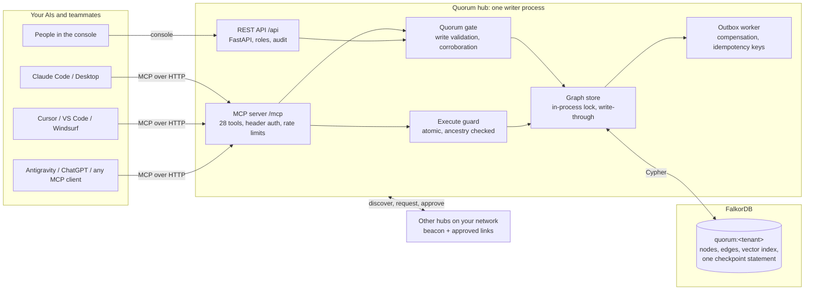
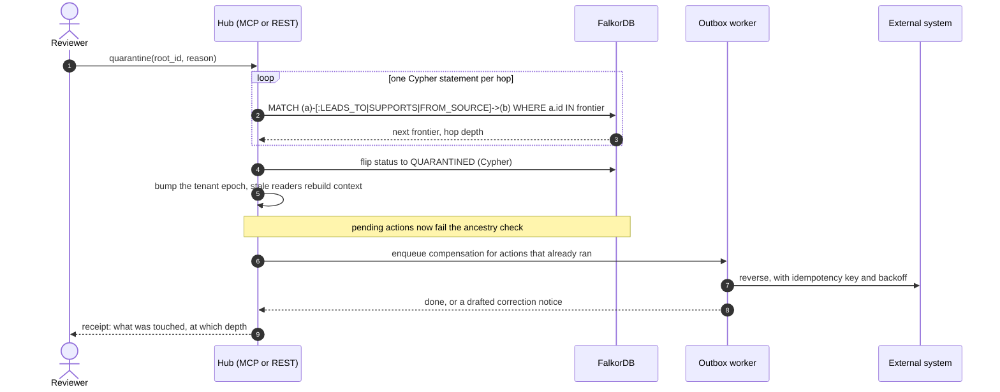
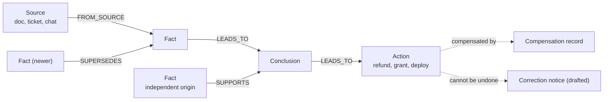
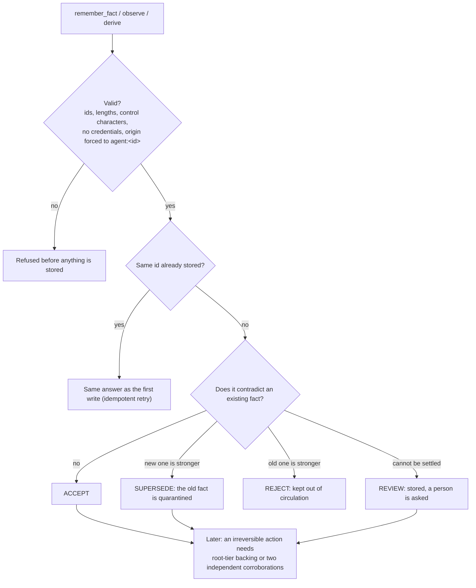

# Architecture

How Quorum is put together, in four diagrams. Every box names a real module; every claim about FalkorDB is checkable with `GET /api/falkordb/proof`.

## The system

**Single writer.** Execute guards and handoff claims run under a process lock; FalkorDB answers the ancestry question inside the lock. Separate API workers or standalone MCP writers are not supported (see [`../SECURITY.md`](../SECURITY.md)).

## What one correction does

The traversal is level-synchronous: each hop is one statement, so the depth of a chain is not limited. Above 5,000 hops the hub falls back to an unbounded in-process walk and says so in the proof endpoint.

## What the graph holds

Every node carries its owner, scope (private, team, shared), a status (`HEALTHY`, `SUPERSEDED`, `QUARANTINED`), and bitemporal fields (`valid_from`, `valid_to`, recorded time) so `recall_as_of` can answer "what did we believe then?".

## How a write is judged

Every outcome comes back with a plain-language receipt.

**Independent** means: a different asserter, no shared `copied_from` lineage, a different source node and host, a different origin label with the `agent:` prefix stripped, and wording that is not identical or near-identical. A claim that is a reworded copy with no trace cannot be detected by any provenance system; that boundary is stated in [`HACKATHON.md`](HACKATHON.md).

## Where each decision runs

| Decision | Engine |
| --- | --- |
| Which facts, conclusions and actions depend on a wrong fact, and how deep | FalkorDB (Cypher, one statement per hop) |
| Is every ancestor of this action healthy | FalkorDB (the same traversal, incoming edges) |
| Blast-radius preview | FalkorDB (read-only) |
| Path between two facts | FalkorDB (`shortestPath`) |
| Semantic half of retrieval | FalkorDB vector index |
| Durable recovery state | FalkorDB (one `MERGE` checkpoint plus replayable projections) |
| The atomic check-and-set | The hub's lock (FalkorDB supplies the ancestry answer) |
| Keyword half of the ranking blend | The hub |

Details and the verification recipe: [`FALKORDB.md`](FALKORDB.md).

## Code map

| Path | What lives there |
| --- | --- |
| `backend/app/main.py`, `routes/` | REST API, auth, rate limits, the read-only-POST fast path |
| `backend/app/mcp_embed.py`, `services/mcp_*.py` | The 28 MCP tools: memory, coordination, chat layer |
| `backend/app/services/gate.py`, `executor.py` | Write gate, corroboration, atomic execute guard |
| `backend/app/graph/queries.py` | The graph store, group commit, FalkorDB-native traversals |
| `backend/app/persistence.py`, `db.py` | Write-through persister, FalkorDB client and health |
| `backend/app/services/federation.py`, `scripts/quorum_beacon.py` | Discovery, connection requests, approvals |
| `backend/app/services/guide.json`, `guide.py` | The use guide: one source for chat, REST, console, docs |
| `frontend/` | The console and landing page (React, Vite, Cytoscape) |
| `bench/` | Every number in the README, as a re-runnable script plus its result file |
| `scripts/` | `setup.py`, `judge.py`, `doctor.py`, `e2e_connect.py`, generators |

## The four safety layers

Quorum enforces four deterministic, non-LLM safety layers:

1. **PREVENT (Layer 1 — The Quorum Gate):**
   - Evaluated during `stage_action`.
   - Irreversible and financial operations require either root-tier policy backing or independent corroboration from 2+ distinct agent origins (`SUPPORTS` edges).
   - If uncorroborated, stale, or quarantined, the action is **BLOCKED** and routed to a human `REVIEW` handoff queue. Reversible/compensable actions are permitted.

2. **GUARD (Layer 2 — Atomic Execute Guard & Tombstones):**
   - The in-process lock around `execute_guard` verifies that the action is `HEALTHY`, gate `PASSED`, not yet executed, and has **zero non-healthy causal ancestors** across both `[:LEADS_TO|SUPPORTS*]` paths.
   - If an action races against a quarantine wave, it is aborted with zero rows returned.
   - If an external call was in flight, the **Helpdesk Tombstone Engine** records a tombstone for compensations arriving first; any subsequent late execution attempt is strictly rejected with `409 Conflict`.

3. **REPAIR (Layer 3 — Quarantine Red Wave & Outbox Saga):**
   - Unbounded cascade follows `[:LEADS_TO|SUPPORTS*]`, marking all derived descendants `QUARANTINED` with their hop depth and root anchor.
   - Atomically increments the tenant's **Context Epoch**. Any agent making MCP calls with a stale epoch is forced to rebuild context.
   - Strikethroughs in the **Prompt Diff** visually and programmatically remove quarantined facts from LLM context.
   - An asynchronous **Outbox Saga Worker** leases pending compensation rows and calls external APIs with backoff and idempotency keys to reverse executed side effects.

4. **DAMAGE CONTROL (Layer 4 — Automated Retraction Notices):**
   - When an executed `IRREVERSIBLE` action (e.g. an email already sent to a customer) is hit by the Quarantine Cascade, Quorum automatically intervenes.
   - Generates a structured `CorrectionNotice` linked to the verified truth (`Finance Ops Policy Doc v3.0`) and drafts a ready-to-dispatch retraction email for 1-click human review in the Incident Command Room.
